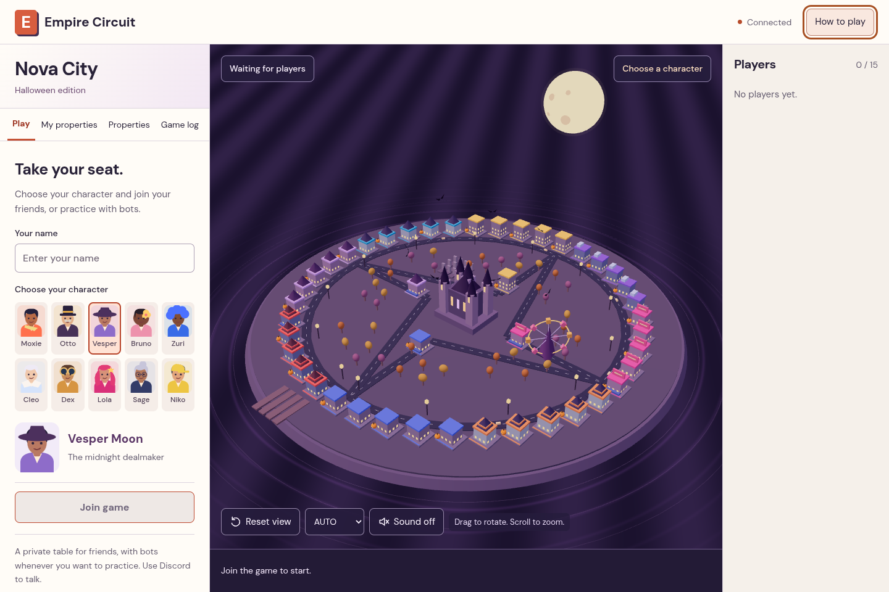

# Empire Circuit — Nova City After Dark

A private, single-session, 4–15-player browser board game. React/TypeScript + Three.js render Nova City; one Fastify/Socket.IO server owns all game rules, RNG, seats and persistence. No accounts, room codes, database, or external services.


## Run

Node.js 22.12+ (tested with 24.19), npm 11.

```sh
npm ci --cache /workspace/.npm-cache
npm run dev
```

Vite serves the client on port 5173 and proxies sockets to the server on 3001. Friends must access the **same** running website. Do not run a separate server per player.

For a single-process build:

```sh
npm run build
npm start
```

The server serves `dist/` and Socket.IO on port 3001. `PORT` overrides the listening port; `SAVE_DIR` overrides the snapshot directory (default `save/`). Bind a reverse proxy with HTTPS to this port when hosting for friends. Localhost URLs are for local development; this repository does not publish a hosted website.

## Playable loop

1. Enter a display name, choose one of the ten original characters, and join.
2. Four to fifteen connected players mark ready. The host starts Capital Race.
3. A seeded shuffle establishes turn order. Each round starts with 25 seconds of simultaneous planning/development.
4. Roll two server-generated dice, choose roads at junctions, acquire properties and pay opponents revenue. Passing HQ awards $200. Turns and route decisions have automatic timeouts.
5. Own 2 district properties for +10% revenue. Own 3 to unlock development and 6 total zoning levels; all 4 unlock landmarks and 12 total levels. Developments physically grow on the board.
6. A negative cash balance opens a 45-second crisis window. Sell development at half cost, or declare bankruptcy. Bankruptcy releases properties to the city; more advanced creditor auctions belong to later milestones.
7. After 12 rounds, highest cash + property purchase values + development investment wins. Ties follow the established turn order. The last solvent player wins immediately. Host rematch retains seats and resets the board.

Momentum is recorded (maximum 2) when rolling doubles; spending abilities belong to a later milestone. Opportunity/civic spaces currently award fixed, visible grants.

## Reconnect and persistence

The browser retains a cryptographically random reconnect token in localStorage. Seat identity is independent of socket IDs. Multiple tabs using the same token share one seat; separate browser profiles represent separate players. The server never broadcasts reconnect tokens or RNG state.

The server serializes snapshots atomically to `save/current-game.json` after state changes and on graceful shutdown. This file contains authentication tokens: keep it private, never commit it. On restart, an active match restores paused. The first returning player takes host control if the previous host is offline, then presses Resume. Reset returns to the lobby. To discard an abandoned session completely, stop the server and remove its snapshot directory.

Saving is local to one server filesystem. Abrupt machine or disk failure can lose the most recent queued write. There is no multi-server or cloud backup guarantee.

## Validation

```sh
npm run lint
npm run typecheck
npm test
npm run build
npm run test:browser
```

Vitest covers transactional rules, deterministic rolls, routes, purchases, revenue, district development, financial crises, rematches, and complete 4/10/15-player matches. A real Socket.IO integration test connects 15 clients, rejects a 16th, checks authorization, reconnects a seat, restarts the server and verifies restoration. Playwright checks the rendered client, token selection, readiness, solo bot simulation, refresh recovery, property inspection and mobile layout with Chromium. Configure `CHROMIUM_PATH` if Chromium is not installed at `/usr/bin/chromium`.

## Code layout

- `packages/shared`: serializable types, Nova City graph, Zod command schema.
- `packages/game-core`: transactional phase machine and pure property calculations. No React, Three.js, network or filesystem dependencies.
- `apps/server`: socket transport, seat authentication, timers, atomic JSON snapshots and HTTP serving.
- `apps/web`: HTML HUD, Zustand socket store, procedural 3D city, local animations and opt-in synthesized sound.
- `SPECIFICATION.md`: full supplied product specification.

## Scope and remaining work

The original delivery targeted Milestone 1; the After Dark update below adds the subsequently requested bots, new cast, and Halloween visuals. The city uses procedural placeholder models and basic street interpolation. Dice settle with the server result, ownership uses accents plus readable owner names, and tokens have distinct silhouettes. Camera supports orbit, zoom, pan and reset; automatic cinematics and spline smoothing remain future polish.

Auctions, trading/contracts, loans, economic cycles, dynamic demand, executives/objectives, policy voting/projects, premium GLB assets, weather/night lighting, advanced audio, wealth graphs and other modes are intentionally deferred to milestones 2–7. No FPS claims are made: browser validation in this environment uses software WebGL, not representative gaming hardware. Mobile controls and canvas are responsive; the player list and simulation controls are available under Players on smaller screens.

## After Dark update — bots, cast, Halloween city

This version adds host-controlled practice opponents and the **Nova City After Dark** visual theme. The supplied master specification remains the original brief; this update follows the later requests for bots, no text chat, and ten original people.



### Play solo or watch a simulation

1. Join and choose one of ten original people: Moxie Vale, Otto Brass, Vesper Moon, Bruno Bloom, Zuri Volt, Cleo Frost, Dex Dune, Lola Lux, Sage Sterling or Niko Nova. Each has a matching illustrated portrait and distinct procedural 3D outfit/silhouette.
2. Press **Add a bot** at least three times. Bots are ready automatically; total seats remain capped at 15. Remove unwanted bots with × before starting.
3. For manual practice, leave **Play my turns automatically** off. Bots roll, choose routes, buy, develop, recover from crises and end their turns on the server.
4. To watch a complete simulation, enable **Play my turns automatically**, set **Bot speed → Fast**, mark yourself ready and start. Only the host's seat is automated; other humans retain control and planning time. Autoplay turns off if host control transfers to another human. Fast mode skips planning only when all active seats are automated.
5. Pause/resume at any time. Disable autoplay to take back control. Rematch retains bots and returns them ready to the lobby.

Bot decisions use public information and the same transactional rules as humans; they cannot see future RNG or receive free cash. They reserve liquidity, prefer useful acquisitions, avoid expensive opponent landings, develop eligible portfolios, and sell development during a crisis. They are heuristic practice opponents, not competitive or human-level AI.

Text chat and its socket command/history have been removed; use Discord for voice. The sidebar now contains standings and practice controls. Click a player to see their character and portfolio. Pre-update JSON saves migrate old generic token IDs to the new cast and discard chat history.

### Visuals and rendering

Warm parchment/coral interface; violet Halloween island; gothic central exchange; moon, bats, pumpkin props, cemetery garden, waterfront piers, lanterns, illuminated windows and a rotating carnival wheel. District properties have different rooftop details; developed buildings grow taller. Roads remain clear of lots, and the camera fits the viewport on phones as well as desktop.

Repeated city solids, windows, vegetation, Halloween props, roofs, pumpkins and traffic use instanced meshes rather than separate meshes per detail. Window/lantern faces use unlit materials instead of many real lights. HIGH uses a cached 1024px directional shadow map; AUTO adjusts resolution gradually between 0.7 and 1.3, LOW removes traffic/carnival decoration and shadows. Reduced Motion stops traffic/carnival movement and snaps character/dice animations to their result. Bundled fonts need no external network fetch.

Tests include 100 seeded complete matches through the real bot scheduler, seat limits/permissions, manual-human protection, pause/rematch, crisis recovery and save migration. The browser test plays a solo bot match through to results and rematch, checks all ten character choices, confirms chat is absent, and captures desktop/mobile views. The four-player AUTO scene stayed below 200 draw calls in the renderer regression check. FPS on physical phones/laptops remains unbenchmarked; these are concrete rendering improvements, not an FPS guarantee.

## Readability and performance update

The interface now uses one bundled font with 16px body text, 14–16px controls, and 12px or larger supporting labels. Main tabs are **Play**, **My properties**, **Properties**, and **Game log**. Duplicate rankings, decorative slogans, small map district labels and unused-resource counters have been removed. Rent calculations are available on demand under “How rent is calculated”. Special city spaces describe their actual effect instead of showing a property price. Bot controls use plain wording: **Add a bot**, **Play my turns automatically**, and **Bot speed**. Dialogs support Escape, keyboard focus trapping and focus return.

The Halloween setting and ten original people remain. At route junctions, the available roads light up; on your turn you can choose a highlighted road directly on the map. Only the current and local player's names are displayed continuously above characters; hover or click another character to inspect them.

Rendering now batches each person's body parts into 2–3 cached meshes, and batches the carnival wheel and moon details. Unchanged city tiles and player objects are reused across socket snapshots, and city geometry is rebuilt only when its visual inputs change. The countdown updates its own panel rather than the entire application. Bots use a read-only development eligibility check instead of cloning the whole game repeatedly to test possible builds.

The browser regression test measured **36 draw calls with 4 players and 72 with 15 players** on AUTO, compared with 98–108 for the previous four-player scene. Checks require fewer than 55 and 100 respectively, and verify the sample represents the current player count. These are draw-call measurements, not hardware FPS guarantees. The game rules remain unchanged in this readability pass; character powers and additional economy mechanics have not been added.
