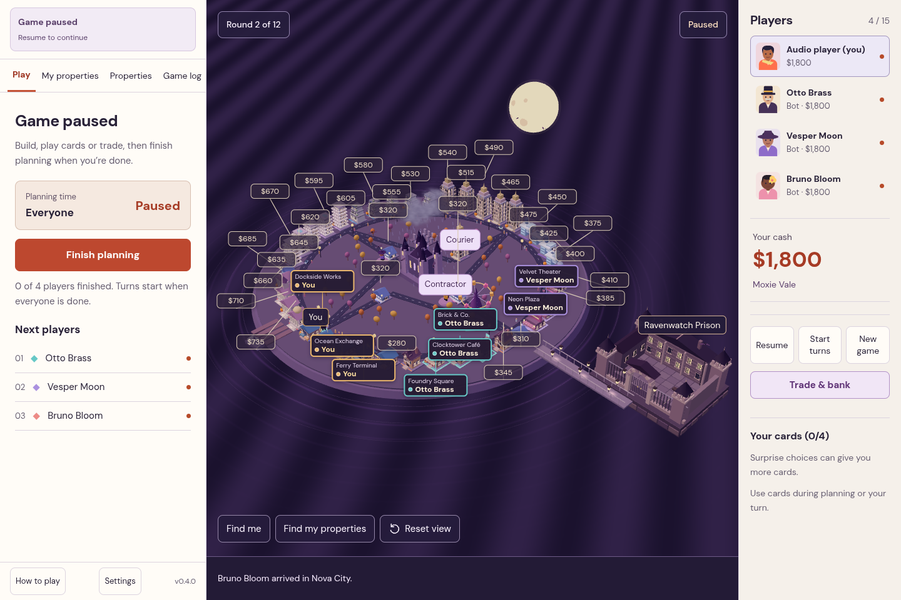
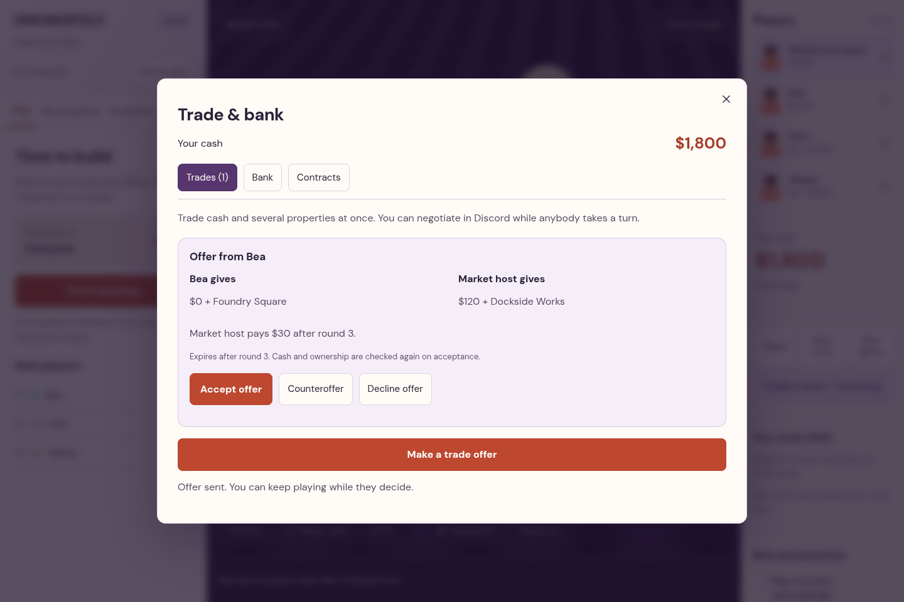

# ZMONOPOLY v0.4.0 — City in Focus

A desktop browser game for one private group: 4–15 total seats, including optional bots. One city, one authoritative server, no accounts, rooms, database, matchmaking or text chat. Use Discord to talk.



## Preview and review

[Watch the gameplay preview](docs/zmonopoly-preview.mp4) · [What the recording shows](docs/PREVIEW.md) · [Logic, performance and playtest review](docs/AUDIT.md) · [Hosting steps](docs/HOSTING.md)

v0.4.0 makes property ownership permanent on the 3D map: player-colored plot borders and flags, owner names, sale prices, and hover details. One small Settings button contains graphics, storm and audio controls. Master, game-effect and alert volumes save per browser, with optional movement/interface/other-player sounds. Gameplay cues follow state changes and confirmed actions; turn alerts bypass busy-board effect throttling. Each new auction bid reopens every rival’s response, so old passes cannot award an instant win.

v0.3.3 removes the sidebar game-name, release-name and always-connected header. Gameplay starts at the top of the sidebar, with help and a small version number in its footer. A reconnect notice appears only when a seated player loses the connection.

v0.3.2 adds detailed illuminated facades, an isolated Ravenwatch Prison and larger animated bat colonies. A navigation map, property search, ownership arrows and a persistent turn/custody banner make the city easier to follow. Only your own manual roll opens fullscreen dice; other rolls leave your controls available. Sound is interactive only. Round one starts with movement; subsequent rounds include planning. Each player has one shared five-minute turn budget, preserved across decisions, auctions, pauses and server restarts.

[See the ownership, audio and auction update](docs/CITY-IN-FOCUS.md). Production starts compiled JavaScript with no development runtime dependencies.

## Launch

Requires Node.js 22.12+; tested with Node 24.19.

```sh
npm ci
npm run build
npm start
```

Open `http://localhost:3001`. Friends on the same network open `http://YOUR-COMPUTER-LAN-IP:3001`; allow the port through the host firewall. For friends elsewhere, host this single server behind HTTPS at a shared address. This repository does not deploy a public website automatically.

In the Codex cloud checkout:

```sh
cd /workspace/Monopoly-
npm ci --cache /workspace/.npm-cache
npm run build
npm start
```

The checkout path intentionally remains unchanged. `PORT` overrides 3001; `SAVE_DIR` overrides the default private `save/` directory. Development mode is `npm run dev`: Vite on 5173 proxies to the same single game server on 3001. Do not run two servers against one save directory.

## Start a game

1. Enter a name and choose one of ten original people. Sound starts after joining if “Sound on when I join” is checked; it never autoplays on opening the page.
2. Invite friends or click **Add a bot** at least three times to practice alone. All humans click **I’m ready**; bots are ready automatically. The host clicks **Start game**.
3. For a complete hands-off simulation, enable **Play my turns automatically** and choose **Fast** bot speed. Other human seats are never automated. Only your own manual rolls show full-screen dice. Other players’ results appear in a small nonblocking city banner.

## New in v0.3.0

**Trade & bank** opens the economy desk during planning and off turn. Unaccepted offers are private; accepted contracts are public. Finish an auction or return to planning before making other deals.

- **Trades and counteroffers:** offer cash and several properties on each side. Accept, decline, withdraw or counter. A counter replaces the previous terms, and the server checks cash, ownership and building capacity again on acceptance. Offers expire after two rounds. Pending offers do not reserve funds. Pledged or contracted properties cannot change hands outside their agreement.
- **Live auctions:** declining an unowned property opens bidding for all solvent players. You have up to five minutes, and a late bid leaves at least a minute to respond. Bids are binding, increase by at least $10 and use cash only. A pass applies to the current price. Every higher bid reopens all rivals’ responses. The auction ends early when every rival passes that latest price; the leading bidder cannot force it closed. The winner pays once and receives the property; with no bids it remains unsold. **Find auction** locates its animated marker.
- **Bank loans:** pledge one or more free properties and borrow up to 65% of their base plus development value. Credit ratings set a fixed 5%, 8% or 12% rate per round. Interest starts at the end of the next round. Principal is due after three rounds; exact dates are displayed. Partial or full early repayment is allowed. Full repayment releases collateral. Refinancing draws unused equity at the existing rate and due date. Pledged development can be improved but cannot be stripped or transferred.
- **Contracts:** add up to three preset clauses to a trade: a future payment, a private loan, a 10–50% property revenue share, one or two rent-free district visits, or an exclusive purchase option. Both players approve all terms. Repayments happen automatically after their due round; revenue shares split actual collected rent, immunity applies before shields, and options recheck cash and legal district control when exercised. Revenue shares and options lock their property until expiry or exercise. The Contracts tab shows exact terms and lets beneficiaries exercise options.
- **Recovery:** a player short of cash can borrow, accept a deal, sell unpledged development or auction an undeveloped property. Round-end obligations pause the transition into planning or final scoring until every shortfall is resolved. Unfunded payments remain visible claims, not spendable money for creditors. As cash is raised it funds those claims; bankruptcy writes off their unpaid portion. Overdue principal keeps its collateral locked until funded. Bankruptcy settles secured bank claims at 65% collateral value, distributes available cash proportionally to private creditors, writes off remaining claims and returns remaining assets to the city. It does not silently transfer an entire empire to one creditor.
- **Modes:** Capital Race lasts 12 rounds. Blitz lasts 8, starts each player with $2,400 and makes development 25% cheaper; it keeps the generous decision timers. Domination ends early with one solvent player, or at 30 rounds uses highest net empire value; after round 12, a public levy starts at $100 and rises by $75 each round. The levy is capped at available cash, so it drains liquidity without creating simultaneous bankruptcies. The host chooses the mode before readying up; changing it resets human readiness.
- **Net scoring and statistics:** available nonnegative cash + base property/development value + receivables − bank debt − promised repayments. Results show trades, auctions won and rent collected. Borrowing cash does not increase score. Market value ranges aid negotiation; scoring still uses the transparent base-value formula.

Characters face their route and walk with articulated limbs. Property acquisitions and construction have brief 3D feedback. Bids pulse, completed auctions have a gavel animation, trades announce completion, and cash gains or expenses float briefly beside the game. Sound cues distinguish bidding, winning, borrowing and trading. Reduced Motion disables movement effects; fast bot simulations shorten celebrations and skip construction effects.



## What happens during play

- **Opening:** round one begins immediately with rolling and buying.
- **Planning:** from round two, up to five minutes to build, use cards and visit service characters. Click **Finish planning** when done. Turns start immediately when all active players finish; use **Back to planning** to change your mind while others are still planning. The host can also start the turns early.
- **Movement:** two server-generated dice, shown in a large, skippable 3D animation. At junctions, choose the outer road or a shortcut. Rolling, route selection, purchasing and the surprise share one five-minute turn. Completing actions advances immediately. Auctions pause that budget and use a separate timer; cash recovery gets ten minutes and then returns the unused turn time. Pause/resume and server restarts preserve the remaining time.
- **Properties:** buy unowned lots or pay rent to rivals. Own 2 of a district's 4 properties for +10% rent. Own 3 to build with 6 total development levels; own all 4 for 12 levels and landmarks. Models physically change as levels rise.
- **Surprises:** each movement turn ends with one of 14 two-option encounters. Choose cash now, cards, future savings, protection, travel or an explicitly risky deal. You can skip instead. Resolving the choice ends the turn immediately.
- **Cards:** start with one card; hold at most four. Rent Shield blocks a payment, Contractor Favor saves building costs, Express Pass adds movement, Emergency Grant gives cash, Market Coupon saves on a purchase, and Alibi releases a detained player. Use or discard cards during planning or your own turn. Opponents receive hidden card backs, not the card types.
- **City events:** six rotating conditions change rent, building costs, property prices or HQ income. The current effect and next-round forecast are visible. Discounts and bonuses are applied by the server, with rent calculations available in the property panel.
- **City characters:** click the Card broker, Contractor or Courier during planning. Buy a chosen tactical card, prepay building credit, or buy extra movement. Every service costs cash and each player may use one service per round.
- **Custody:** illegal deals disclose a 40% arrest chance before acceptance. If caught, a police-car animation escorts the character to the isolated Ravenwatch Prison. Pay $200 bail, play Alibi, or serve two movement turns. Properties keep collecting rent. A personal arrest notice explains your choices, and a custody banner stays visible across sidebar panels. Find me locates your character even in custody.
- **Cash shortfall:** ten minutes to play cash cards, sell unpledged development at half its base cost, borrow, trade or auction an undeveloped property. The recovery rules above apply if the balance cannot be covered.
- **Winning:** Capital Race and Blitz use net empire value after their round limit; Domination ends with one solvent player or uses net empire value after 30 rounds. Ties follow the shuffled turn order. **Play again** retains connected seats, bots and the selected mode.

## The city and sound

Eight districts use custom procedural architecture: dock warehouses and gantries, brick gabled townhouses, neon theaters and an arena, glass laboratory campuses, Art Deco financial towers, eco terraces, luxury balconies and pools, and columned civic buildings. Special stations and utilities have their own forms. Framed windows, mullions, shutters, doors, balconies and warm window halos add street-level detail. Ravenwatch Prison sits beyond a long railed causeway, with barred cells, watchtowers, lanterns and an animated gate. Ownership remains an accent rather than recoloring entire buildings.

Storm clouds drift above the central castle, with rain, occasional branching lightning and one brief local light. A ferry, detailed cars, sidewalk pedestrians, bats, autumn trees, pumpkins and a carnival wheel animate the city. **Storm off**, lower graphics quality and Reduced Motion reduce effects. Weather, pedestrians and vehicles never determine gameplay outcomes.

The sound engine uses original synthesized dice rattles, quiet footsteps, route prompts, card effects, surprise/service cues, purchase/build/sale motifs, bidding/trade/loan/payment sounds and distinct turn/custody/crisis/result alerts. There is no continuous wind or ambient sound loop. No sound files or remote fonts need downloading during play. Open **Settings** in the sidebar footer. **Master volume**, **Game effects volume** and **Alert volume** are independent sliders. **Sound enabled** mutes everything; movement sounds, interface clicks and other players’ actions have separate switches. Test buttons let you hear the mix. Preferences save in this browser and do not change anyone else’s settings. Saved audio resumes after the next browser gesture. Muting cancels scheduled sources, including dice rattles; alerts have a separate channel so busy board effects cannot suppress your turn.

The current player is marked in the player list, overhead and in a persistent sidebar banner. Your browser tab title signals your turn. Owner names, colored plot borders and rooftop flags identify every owned property directly on the map. Unowned properties show their purchase prices; hover or focus a pin for its full name, district, owner, rent and development level. Clicking a pin focuses that property. Ownership is always visible and has no settings toggle. The Properties panel includes a clickable navigation map and search by name, district or owner; selecting a result focuses its building. **Find me**, **Find current player** and **Reset view** help with navigation. Drag to orbit and scroll to zoom. Phone-specific layouts and controls have been removed; the layout targets desktop windows at least 1200px wide. There is no commercial page header. The sidebar always shows the real package version.

## Reconnect and save

A cryptographic reconnect token in browser localStorage identifies a seat independently of socket IDs. Separate browser profiles represent separate people; multiple tabs with one token share one seat.

The server saves the real state, RNG seed and seat tokens atomically to `save/current-game.json` after changes and on graceful shutdown. Keep this file private and out of Git. After restarting, an active game restores paused. Reconnect and have the host resume. If host control transfers to another human, autoplay turns off. Older saved states gain default card, event, timing and custody fields on load.

Snapshots queued immediately before a hard machine/disk failure may be lost. This is single-machine persistence, not a cloud backup service. To discard an abandoned session, stop the server before removing its save directory.

## Validation

```sh
npm run lint
npm run typecheck
npm test
npm run build
npm run test:browser
```

Vitest checks transactional rules, routes, timers, early planning completion, private hands, card effects, encounters, services, event prices, custody, migration and victory. One hundred seeded bot matches exercise full games in the test suite. An additional repeatable 270-match audit checks ownership, cash shortfalls, collateral, building limits and all three modes; see docs/simulation-audit.json. Real Socket.IO integration connects 15 clients, rejects a 16th and verifies reconnect/restart behavior. Browser tests play through results/rematch, inspect the scene, verify large dice and test a seeded police-escort/bail flow. Two independent browser sessions negotiate a multi-property counteroffer, accept a future-payment clause, borrow and repay against collateral, and contest a live auction. Seeded simulations exercise all three modes. Chromium defaults to `/usr/bin/chromium`; override with `CHROMIUM_PATH`.

Browser text assets have Brotli and gzip variants; hashed assets cache immutably and HTML revalidates. The city stops rendering while hidden or fully covered by dice/dialogs. Static instance colors are uploaded once instead of every frame. Repeated architecture, pedestrians, cars and props are instanced. Unchanged snapshot data and visual geometry are reused. AUTO adjusts rendering resolution gradually; HIGH uses a cached directional shadow map. The previous release's draw-call figures are not a claim about this expanded scene. Current regression tests measure the new scene; no hardware FPS guarantee or human balance claim is made.

## Version and source

`package.json` is the source of the displayed version and `/api/health` version. Release tags identify exact builds; this release is `v0.4.0`. Future game releases should increment the package version and receive a matching Git tag.

The intended game/repository name is **ZMONOPOLY**. The source is currently hosted at [zogzi/Monopoly](https://github.com/zogzi/Monopoly). The environment's GitHub administration API is blocked (CONNECT 403), so the repository itself has not been renamed. The owner can use [Repository Settings](https://github.com/zogzi/Monopoly/settings) → General → Repository name → `ZMONOPOLY`; GitHub redirects the previous Git URL after renaming.

## Code and design notes

- `packages/shared`: types, authored cards/encounters/events, release version and timing constants.
- `packages/game-core`: authoritative transactional rules, pure financial calculations, private snapshots and bot decisions.
- `apps/server`: Fastify/Socket.IO, authentication, pacing, persistence and static serving.
- `apps/web`: readable HTML controls, procedural 3D architecture, atmospheric effects and local presentation.
- [Design rationale and reviewed references](docs/DESIGN.md).
- `SPECIFICATION.md`: the original full product brief; later user requests authorize this release's additional mechanics and desktop focus.

Trading, public auctions, secured loans/refinancing, the five preset contract types and all three game modes are implemented in this release. Multi-party deals and sealed auctions remain optional later extensions. Visuals are custom procedural models rather than commissioned GLB assets. Bot simulations prove execution and invariants; human playtesting is still essential for balance and fun.
