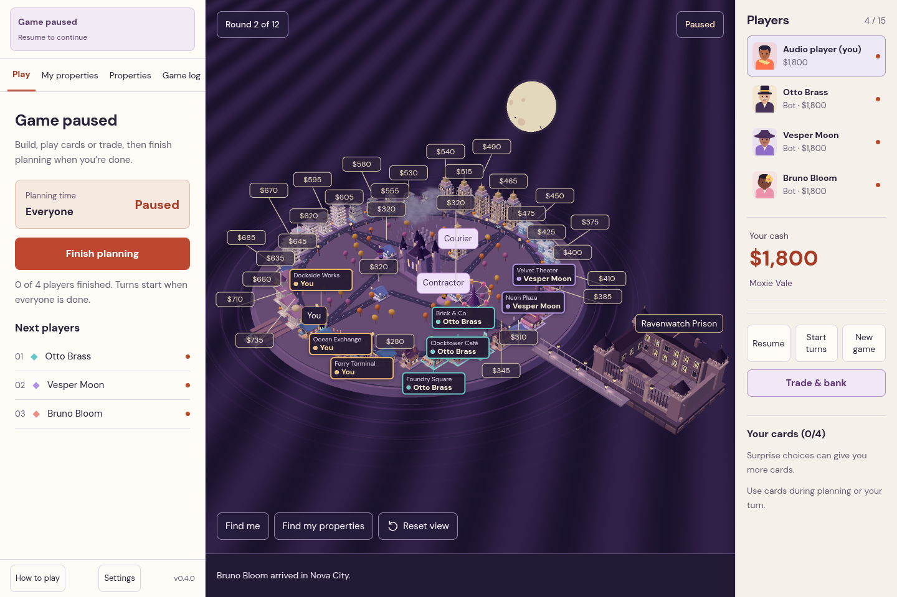
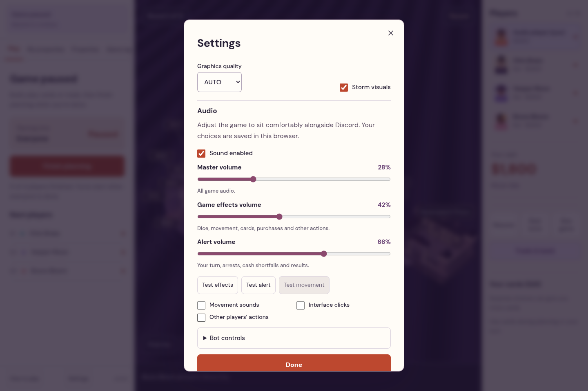

# ZMONOPOLY v0.4.0 — City in Focus

[Gameplay and recorded audio preview](zmonopoly-preview.mp4) · [Launch](../README.md#launch) · [Hosting](HOSTING.md)

## Ownership directly on the map

Player-colored plot borders, rooftop flags and owner labels are always visible. Your properties say **You**. Unowned properties show purchase prices, including your active coupon discount. Hover or keyboard-focus a pin to see its full name, district, owner, rent and development level. Click it to focus the property.

Labels follow camera movement and are placed to avoid one another, the service characters and your/current-player markers. There is no ownership-visibility toggle. Camera navigation, the round/current phase and the active character remain available during play. Graphics, storm, audio and in-game practice controls are behind one small **Settings** button. Autoplay shows a direct **Take control** action on the map.

## Adjustable interaction sounds

**Master volume**, **Game effects volume** and **Alert volume** are independent. Movement, interface clicks and other players’ actions have separate switches. Test buttons preview the mix. Preferences save locally in each browser, survive refresh and do not alter other players’ levels. Sound requires the normal browser gesture after a refresh.

Cues cover joining/readiness, full dice animation and shorter remote/reduced-motion rolls, visible footsteps, route choices, cards, surprises, city services, purchases, development/sales, money changes, offers/trades, auctions, bank borrowing/refinancing/repayment, custody/release, recovery, round/turn transitions, pause/resume and results. They follow actual game-state changes and acknowledged commands instead of matching the latest log string. Historical events do not replay on reconnect.

Local turn/crisis/result alerts bypass effect throttling. The engine limits overlapping voices, prioritizes alerts and disconnects completed sources. Muting cancels queued sources, including future dice rattles; skipping the dice presentation cancels its remaining sound. There is no wind or ambient loop.

## Fair auction responses

Previously, someone could pass before a later bid and their old pass would still count toward ending the auction. A late bidder could therefore win immediately without a fresh response from those rivals.

Each new bid now clears the previous passes. Every rival can bid or pass at that price. The auction closes when every rival passes the current price or the server timer expires. The leading bidder cannot end/skip the auction or pass while holding the binding bid. Higher bids still leave at least a minute to respond, and auctions retain their separate five-minute budget.

Old saved auctions discard stale passes on migration while preserving the binding bid. The panel lists who can still respond, so early settlement is understandable.

## Verification

- Lint, TypeScript and the production build passed.
- **74 tests across nine files** passed, including forced-close rejection, fresh responses after bids, old-save migration, independent audio events, funded-repayment feedback and dense label placement.
- All **seven browser scenarios** passed together: real audio output/settings persistence, two-person trading/banking, live bidding, banking during someone else’s dice, complete bot match/rematch, animated manual dice and custody/bail. Targeted final audio/map checks also verify that ownership pins do not cover the service buttons.
- A real Web Audio analyser measured effects at 0% as **zero output**, while the alert channel still produced a signal. Effects continued to play with alerts at 0%. Master at 0%, mute cancellation and idle output were silent. A second browser context retained independent defaults.
- **270 seeded matches** completed with the new response rules across all three modes and 4/8/15 seats, with no invariant failures. [Results](simulation-audit.json).
- The video records actual gameplay and in-game sound from seeded, isolated saves. It is a demonstration, not a hardware FPS benchmark. The existing Docker/hosting configuration is unchanged; the [previous container audit](hosting-audit.json) identifies its tested release explicitly.
