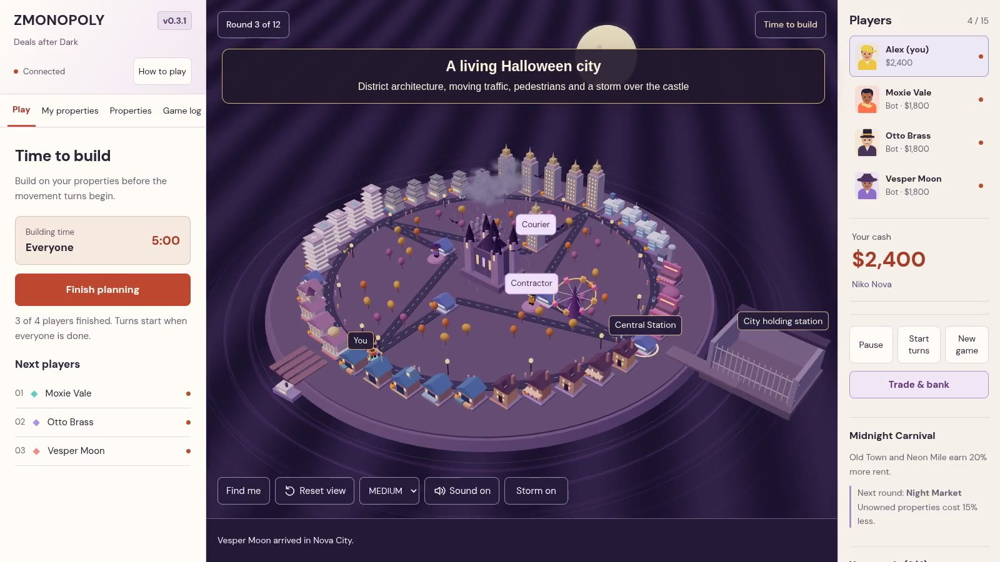

# Gameplay preview

[Watch or download the video](zmonopoly-preview.mp4)



The approximately one-minute MP4 records the actual v0.3.1 browser build at 1600 × 900 and 24 fps, with captured in-game audio. It shows the city, development, fullscreen dice, a surprise decision, bidding, bank borrowing, a private trade and custody/bail.

These are **seeded demonstration scenarios**, not one uninterrupted match. Starting property ownership, cash, the auction and the illegal offer are staged save fixtures. All displayed actions go through the actual client and authoritative server. Captions are added only for the recording. There are no generated gameplay images or replacement sound effects. The cloud browser uses software WebGL; this recording is not a hardware FPS benchmark.

To recreate it with Node development dependencies, system Chromium and FFmpeg installed:

```sh
npm run preview:video
```

This creates isolated temporary game saves and never reads or modifies the real `save/` directory. Intermediate clips live in ignored `artifacts/preview/`. The final MP4 and poster are written here in `docs/`.
