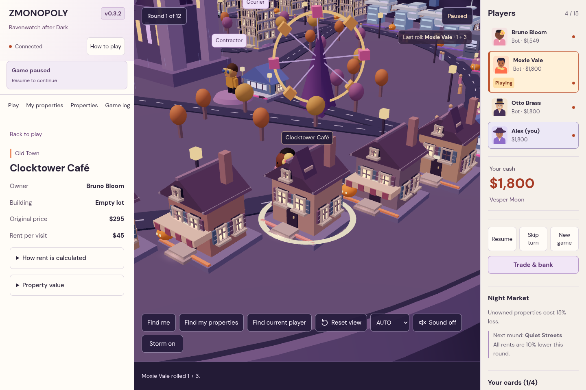
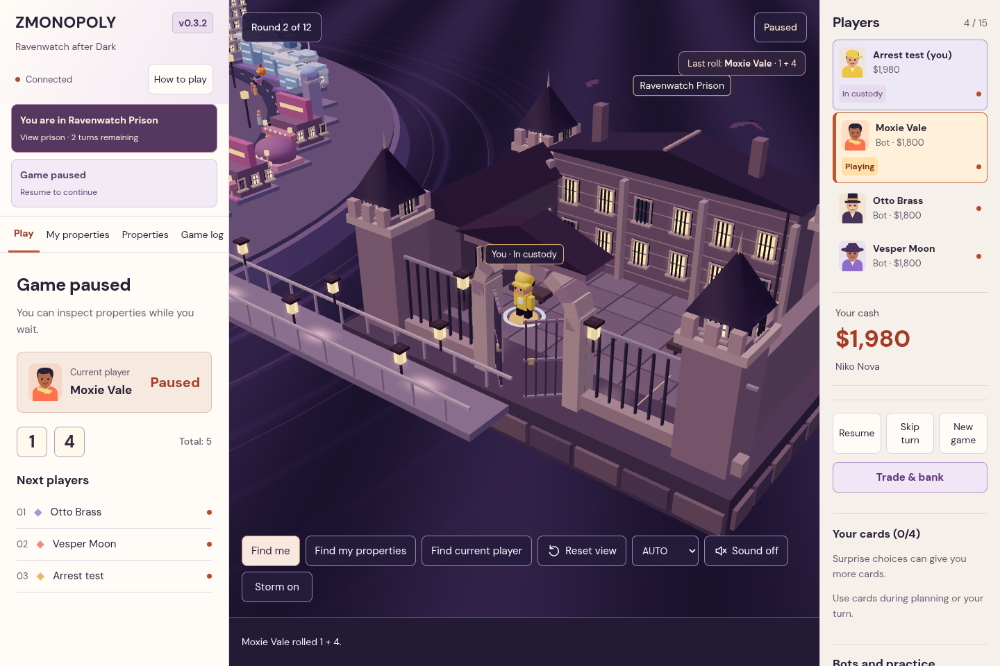

# ZMONOPOLY v0.3.2 — Ravenwatch after Dark

[Watch the actual browser preview](zmonopoly-preview.mp4) · [Launch instructions](../README.md#launch) · [Hosting](HOSTING.md)

This release addresses the latest playtest feedback while retaining the existing trading, auctions, bank loans, contracts, bots, surprises and custody rules.

## Following the game

- A persistent sidebar banner identifies the active player and current decision across every panel. Your turn changes the browser tab title and plays the existing turn chime when sound is enabled. Click the banner to open Play.
- Your properties have gold ground rings and overhead arrows. The My properties checkbox toggles them. Find my properties restores the overview and opens your portfolio.
- Properties includes a clickable city map and search by property name, district or owner. Search ignores accents. Select a result to focus its building; the prison has its own destination.
- Only your own manual roll opens fullscreen dice. The dice fly in, tumble, bounce and settle before revealing the sum. Escape/Continue skips the presentation. Other players’ rolls appear in a compact city banner and leave banking, trading and inspection available.
- Getting arrested opens a personal notice with bail/card/time options and a View prison button. A custody banner remains visible across panels, including after reconnecting.
- Audio contains interaction cues only. The continuous wind and ambient thunder sounds have been removed.

## Opening and timers

Round one starts with rolling and buying. Planning begins in round two, with text that explains what players without property can do.

The five-minute normal timer belongs to a **whole player turn**: rolling, choosing roads, purchasing and the surprise consume the same budget. A new player starts a fresh five minutes. Auctions suspend the remaining turn time and have their own five-minute timer, with the existing late-bid extension. Cash recovery has ten minutes and returns the unused normal-turn budget afterward. Auctioning during recovery also preserves the recovery time. Pause/resume and server restarts retain the remaining time instead of refilling the clock. Completing an action never makes players wait for its timer.

## City detail

Ravenwatch Prison sits outside the city on its own stone quay, reached by a longer railed causeway. It has barred illuminated cells, four watchtowers, an arched entrance, opening escort gates, lanterns, a courtyard, benches and service architecture. The police escort follows the playable roads and causeway; the prison token appears when the car actually arrives. Gate timing starts with rendering, so a slow first frame does not desynchronize the arrival. Detained characters occupy distinct courtyard positions.

District buildings keep their distinct architecture. Framed windows, mullions, sills, warm and dark panes, shutters, doors, steps and balcony details add depth. Window halos and soft ground light use instanced effects rather than one light per window. LOW omits the halos.

The bats have scalloped wings, ears, eyes and animated wingbeats. They circle the castle, moon and prison in one instanced draw, with 6 on LOW, 14 normally and 20 on HIGH. Reduced Motion stops their animation. The default camera includes the city and remote prison; location focus allows closer inspection.

## Verification and practical limits

- Lint, TypeScript, production build and **66 tests across eight files** passed. Regression tests cover the shared clock, separate auction/recovery budgets, pause/resume, immediate opening and exact restart-time preservation. The server integration also holds an unfinished HTTP connection open and verifies shutdown closes it after saving. Existing rules, payment safety, 15-client networking and complete seeded bot matches remain covered.
- All **six browser scenarios** passed, including a complete bot match/rematch, animated manual dice, arrest/escort/bail, two-person trade/counter/contract/bank flow, live bidding and banking while another player rolls. The final run passed all six together.
- The **270-match audit** completed all modes with 4, 8 and 15 seats, checking legal ownership, development, integer cash, funded shortfalls, hand limits, collateral and solvent winners. [Full report](simulation-audit.json).
- The updated production Docker image ran as UID 1000, served Brotli assets with the expected cache policy and exited cleanly with a connected player. Recreating the container from its persistent volume restored four seats, reconnect identity, a paused game and the remaining timer. [Full report](hosting-audit.json).
- Sampled overview rendering used 72–79 draw calls with four players and 105 with fifteen in these browser runs. Counts vary with lightning, camera, development and temporary effects. Browser text assets totaled 1,377,524 bytes raw / 357,460 bytes Brotli in the production build. Neither result establishes FPS on a real PC.

The cloud browser uses software WebGL. The preview shows seeded scenarios and recorded in-game audio, not an uninterrupted match or a hardware benchmark. Human pacing and balance still benefit from a game with your friends; the earlier [design and balance review](AUDIT.md) remains relevant.
